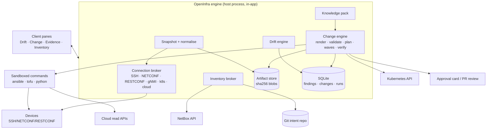

# OpenInfra — plan and product feel

_Status: draft for grilling, 2026-10-22. Base: this repository (Harness Studio 0.3.4, Harness 0.2.1-rc.2 through the `studio` fork)._
_Working names: **OpenInfra** (product), **OpenInfra Studio** (the app; same installer, different profile and brand)._

> **Sequencing update (2026-10-22): we build the CLI and TUI first, the desktop last.** The revised order,
> the CLI's verb/exit-code contract, the TUI's three screens, terminal approvals signed with SSH keys and the
> distribution plan are in [OPENINFRA_CLI_FIRST.md](OPENINFRA_CLI_FIRST.md), which replaces §11 (roadmap) below.
> The object model (§3), safety model (§5), integrations (§6), knowledge pack (§7), drift engine (§8) and
> change pipeline (§9) are unchanged and still apply; "desktop", "pane" and "card" below read as "surface"
> until the desktop exists. The TUI's harness base, its gap list against this fork and its MVP cut are in
> [OPENINFRA_TUI_HARNESS.md](OPENINFRA_TUI_HARNESS.md).

This is one document on purpose: the product decisions, the feel, the architecture, the safety model, the
roadmap and the open questions belong together, because in this product every UX promise is a security or
correctness decision in disguise.

---

## 1. One page

**What it is.** A desktop (later: team server) workbench for network and cloud infrastructure where an agent
does the tedious, read-heavy, evidence-heavy part of operations — gathering state, assembling intent, rendering
and validating changes, watching for drift, writing the runbooks — while every change lands as a **reviewable
plan** that a human approves and a machine executes deterministically.

**The one sentence.** *Read the whole infrastructure for free, write it only through a plan you can read on one
screen.*

**What it is not.**

| Not this | Why not |
|---|---|
| A chat that runs `ansible-playbook` | Un-reviewable, un-auditable, and the model's mistakes go straight to production |
| A new config-management engine | Ansible, Terraform/OpenTofu, Kubernetes, Helm and NetBox already own that ground; we orchestrate and verify |
| A monitoring system | We consume state on demand and on a schedule; we do not replace Prometheus, Suzieq or a NMS |
| An LLM wrapper around vendor CLIs | The value is in **deterministic adapters + a findings/change model**, with the model on top |
| A cloud cost tool, an ITSM, a SOAR | Adjacent; integrate, don't rebuild |

**The wedge.** An individual NetDevOps/DevOps engineer installs one binary, points it at NetBox (or a folder of
YAML/TOML), a Kubernetes cluster (read-only) and a cloud account (read-only), and within ten minutes sees a
**readiness report** and a **drift inbox** that costs nothing to keep running. (First surface: the `openinfra`
CLI, then its TUI — see [OPENINFRA_CLI_FIRST.md](OPENINFRA_CLI_FIRST.md).) The paid reasoning only fires
when they open a finding or ask for a change.

**The promise, in the user's words.**

> "It never touches anything until I've seen the diff. It knows what my network actually looks like, not what
> my repo hopes it looks like. When it's wrong, I can see the query it ran and the raw output. And it costs me
> nothing while I'm not looking."

---

## 2. How it feels (grilling the experience)

### 2.1 Six scenes

These are the scenes that decide whether the product is loved. Each one is a build target with a demo script.

**Scene 1 — The first ten minutes (`infra doctor`).**
You install, pick "OpenInfra" at first run, and get one screen: *Connect*. NetBox URL + read-only token,
kubeconfig, an optional cloud profile, a folder of YAML. Press **Check**. It runs, in the sandbox, a readiness
pass and reports:

```
Inventory      NetBox 4.7.3 · 214 devices · 1,932 interfaces · token: read-only ✓
Devices        181/214 reachable (ssh 22) · 27 NETCONF (830) · 6 RESTCONF (443)
Parsers        ios-xe 96/98 · nx-os 44/44 · eos 38/38 · 3 unsupported platforms
Kubernetes     prod-eu · version 1.35.9 · viewer role verified ✓ · secrets read denied ✓
Cloud          aws:1234 (ReadOnlyAccess, assumed via OIDC) ✓ · no write actions in policy ✓
Intent         inventory/ (YAML) · 214/214 covered · 9 objects with no source of truth
Recommendations  [3]  fix 27 unreachable devices · [1] 5 devices have no NETCONF
```

No model call yet. Every line is a fact from a deterministic probe, and each one expands to the raw command and
output. The last two lines are the only ones a model wrote, and they are labelled as such.

**Feel:** *I have never had an inventory tell me this quickly what it can and cannot do.* The failure mode is
honest: "27 devices unreachable — here is the SSH error for each, grouped by cause."

**Scene 2 — The drift inbox.**
Overnight the app ran 48 snapshot jobs (zero tokens): device running-configs, Terraform/OpenTofu
`plan -refresh-only -detailed-exitcode`, Kubernetes live vs. Git/Helm, cloud inventory vs. state, NetBox vs.
actual. In the morning the **Drift** pane has 7 findings, not 700:

```
HIGH    sw-c-01 · BGP neighbor 10.40.0.6 removed from running-config   first seen 03:12 · 1 device
MEDIUM  aws/eu-west-1 · security group sg-0f2a allows 0.0.0.0/0:22     first seen 02:40 · 3 resources
MEDIUM  vlan 240 exists on 11 of 12 building-C switches               first seen 02:40
LOW     k8s/prod-eu · deployment api-gw image drifted from Git        first seen 03:00
LOW     unmanaged: 14 EC2 instances with no state entry (shadow infra)
INFO    nx-os parser upgrade available (4.8.0) may change 6 findings
```

One row opens a **finding sheet**: intended (from NetBox / Git / Terraform), actual (from the device), the
normalized diff, the last commit that touched the intent, who owns the object, and three buttons: **Explain**,
**Open a change**, **Mute with a reason**. Nothing is applied from here. Explain is where the model earns its
money; the row itself was free.

**Feel:** *the app worked overnight and I didn't pay for it.* Detection is continuous and local; reasoning is
opt-in. This is the economic and emotional core of the product.

**Scene 3 — The change.**
You type: *"Add VLAN 240 to the building-C access switches, same shape as VLAN 230."*

The agent does not touch a device. It: reads NetBox and the local intent, finds VLAN 230's shape, writes the
intent change to a branch (`openinfra/NET-142-vlan-240`), renders configs with the project's templates, runs
`ansible-playbook --check --diff`, `ansible-lint`, `pyang`/Batfish parse, `conftest` policy, and produces a
**Change sheet**:

```
NET-142  Add VLAN 240 to Building C access switches
Intent   1 file, +18 −0   (branch openinfra/NET-142-vlan-240)
Targets  12 devices · site bldg-c · prod ✓ · 1 canary (sw-c-01)
Blast     L2 only · no uplink/IGP/BGP changes · redundant paths unaffected
Plan     sha256:9f2c…  · 12 config diffs (1,208 lines) · rollback: `!` snapshot + revert config
Checks   ansible-lint ✓  batfish parse ✓  conftest 4/4 ✓  tofu plan: no infra change
Waves    1 → 2 → 9   verify after each: vlan-up, trunk, reachability, config-posture
```

The card is one screen. **Approve** approves *that hash*; the executor refuses a plan whose hash changed. The
run happens in waves with a live timeline: per device, the commands, the device's reply, the verification
result, and the artifact links. If verification fails twice, the wave stops and the run offers rollback.

**Feel:** *this is the first agent I would let near a router.* The ceremony is the feature.

**Scene 4 — Ask the network (read-only, instant).**
*"Which access switches in building C are missing VLAN 240, and do any of them have a trunk that would prune
it?"* The agent compiles this into deterministic reads — a NetBox GraphQL query, a `show vlan` and
`show interfaces trunk` over SSH in parallel — and answers with a table and **evidence chips**: every cell
links to the command, the device, the timestamp and the raw output. If a device is unreachable, the cell says
`not read (timeout)` rather than being filled in. Python is available for anything ad hoc: the agent writes a
short script against the inventory API, runs it in the sandbox, and can promote it to a saved check.

**Feel:** *faster than my clipboard, and it shows its work.*

**Scene 5 — Incident, time-boxed.**
*"BGP between r1 and r2 has flapped 9 times since 14:00. Why?"* The session enters **Incident mode**: hard
read-only sandbox, a 30-minute time box, no writes possible, no approvals asked, a timeline pane that
correlates device logs, interface counters, config diffs from the drift store, recent commits and cloud/k8s
events. Output is a written timeline with evidence, and one button: **Open a change** (which leaves incident
mode and starts Scene 3).

**Feel:** *calm under pressure; the tool is not creative when I need it boring.*

**Scene 6 — The next morning, it learned.**
Every applied change recorded its verification and the operator's corrections. The weekly **knowledge refresh**
watch has detected ansible-core 2.22, a NetBox 4.8 API change and a netmiko release, and the app shows a
**Tooling** page: what changed, what it might break in *your* repo (grepped, not guessed), and a one-click
"re-pin and re-run the readiness pass".

**Feel:** *the tool is never stale in the way my runbooks are.*

### 2.2 Ten principles (the non-negotiables)

1. **Read is free; writes are ceremonies.** Detection, inventory reads and drift never require a model call.
2. **No invisible action.** Every state-changing step is preceded by a human-readable plan and followed by an
   independent verification.
3. **Evidence or silence.** Every fact carries `source · query · timestamp · raw output`. "I couldn't read it"
   is a first-class answer; nothing is inferred into a table.
4. **The model writes intent, not commands.** It edits YAML/HCL/playbooks and picks adapters. The executor runs
   fixed verbs.
5. **Dry-run is the default verb; apply is an explicit noun.**
6. **Blast radius before beauty:** targets, count, environment, redundancy, rollback — on the same card as the
   diff, above the fold.
7. **One key stops everything:** a global kill switch plus per-session freeze; both are local, not model-mediated.
8. **The plan is the approval.** Approvals bind to a hash; any edit invalidates them.
9. **Boring beats clever in production.** Templates for recurring changes; creativity is confined to Explore
   and Plan modes.
10. **It explains itself afterwards.** Run timeline, decision log, token and time cost, and a plain-language
    "why this target" for every object it touched.

### 2.3 Modes (each is a sandbox + credential posture, not a prompt)

Harness already holds a session's sandbox read-only while planning; OpenInfra generalises that to four postures.

| Mode | Sandbox | Credentials | Typical use | Exit |
|---|---|---|---|---|
| **Explore** | read-only fs, egress allowlist | read tier | inventory, questions, parsing, Python scratchpad | you |
| **Plan** | read-only fs, writes only to the git workspace | read tier | authoring intent, rendering, validating, planning | approval |
| **Execute** | writes to workspace + device network | **write tier, brokered per run** | waves, apply, verify, rollback | run end |
| **Incident** | read-only, time-boxed | read tier | diagnosis under pressure | time box / you |

UI: a coloured mode pill in the session header, the composer placeholder changes verb ("Ask" / "Plan" /
"Apply"), and Execute mode requires re-authentication of the operator (Touch ID / password) — a small detail
that changes how the tool feels in a room full of engineers.

### 2.4 Surfaces

| Surface | What it is | Where |
|---|---|---|
| **Conversation** | how you ask and review; already exists | existing chat |
| **Change sheet** | the plan, diff, checks, approvals, waves | new right-pane tab |
| **Drift inbox** | findings, owners, severity, mute/explain/fix | new right-pane tab |
| **Evidence** | every query/response/artifact of the current turn | new pane section |
| **Inventory** | the merged SoT: devices, interfaces, IPs, clusters, cloud accounts | new left-pane page |
| **Runs** | timeline of executions with per-target results | inside Change sheet |
| **Artifacts** | content-addressed store: plans, config snapshots, logs, diffs | inside Change sheet + file viewer |
| **Tooling / Knowledge** | pinned tool versions, staleness, upgrade impact | Settings page |
| **Dashboards** | health boards (drift age, unreachable devices, failed runs) | existing Dashboards pane |

Keep Harness Studio's density and keyboard-first feel. A network engineer lives in a terminal and a diff;
the app should feel like a good terminal with better memory, not like a SaaS console.

### 2.5 What must never happen (design the failure paths first)

- A write on a device or cloud account without an approved plan hash.
- Credentials in the workspace, in a prompt, in a log, or in an artifact.
- A fabricated `show` output, a "likely" value in an evidence table, or a silent timeout.
- A plan that silently changes targets between approval and apply.
- A model that can reach production by improvising a command because an adapter lacked a verb.
- A drift report that cries wolf (false positives are the fastest way to be uninstalled).

---

## 3. Object model

Six nouns. Everything else is an adapter.

| Object | Meaning | Lifetime |
|---|---|---|
| **Target** | anything addressable: device, cloud resource, cluster/namespace, host | from inventory |
| **Intent** | the desired state, versioned in git: YAML/TOML files, Terraform/OpenTofu, playbooks, Kubernetes manifests, or referenced NetBox objects | permanent |
| **Snapshot** | a deterministic read of one target at a time (config, plan JSON, live objects) + its hash | retention window |
| **Finding** | a difference or a policy violation, fingerprinted, owned, severity-classed | until resolved/muted |
| **Change** | a proposed modification: intent diff + plan + checks + approvals + waves + verification | permanent (audit) |
| **Run** | one execution of a Change (or of a doctor/drift job) with per-target results and artifacts | permanent (audit) |

### 3.1 A Change on disk

```yaml
# .openinfra/changes/NET-142.yaml  — committed on the change branch, attached to the PR
id: NET-142
title: Add VLAN 240 to Building C access switches
mode: execute
intent:
  files: [intent/sites/bldg-c/vlans.yaml]
targets:
  selector: {role: access, site: bldg-c, platform: ios-xe}
  resolved: [sw-c-01, sw-c-02, ...]     # 12, frozen at plan time
plan:
  hash: sha256:9f2c…                     # covers intent + resolved targets + rendered configs + adapter versions
  artifact: artifacts/9f2c…/config-diff.patch
  summary: "12 devices, 1 site, prod, L2 only, no uplink/IGP/BGP delta"
checks:
  ansible-lint: pass
  ansible-playbook --check: pass (12/12)
  batfish-parse: pass (12/12)
  conftest: pass (4/4)
  tofu-plan: no-change
rollback:
  kind: config-replace
  artifact: artifacts/9f2c…/pre-change-configs.tar.zst
approval:
  - by: you@example.com
    at: 2026-10-22T09:14:03Z
    hash: sha256:9f2c…
waves:
  - {name: canary, targets: [sw-c-01], verify: [vlan-up, trunk, reachability, posture]}
  - {name: small,  targets: [sw-c-02, sw-c-03], verify: [same]}
  - {name: rest,   targets: [sw-c-04 … sw-c-12], verify: [same]}
```

### 3.2 A Finding on disk (SQLite in the app's data folder; YAML export for tickets/PRs)

```yaml
id: drift_01J9…
kind: config-drift            # config | state | policy | shadow | unreadable | version-skew
fingerprint: sha256:41ab…     # normalised diff + target + source, so it is reported once, not 48 times
target: {type: device, id: sw-c-01, platform: ios-xe, site: bldg-c}
sources: {intended: netbox:device/821, actual: ssh://sw-c-01/running-config@2026-10-22T03:12Z}
severity: high                # from policy, not from the model
owner: team-network           # from NetBox tenant/role, git CODEOWNERS, or k8s labels
first_seen: 2026-10-22T03:12:41Z
last_seen: 2026-10-22T03:12:41Z
occurrences: 1
evidence: [artifacts/…/sw-c-01.running-config, artifacts/…/diff.patch]
status: open
```

**Why a fingerprint matters:** a device polled every 30 minutes produces the same diff 48 times a night. The
drift engine reports transitions (new, changed, resolved), never repetitions. That single design choice is the
difference between a tool people keep and a tool people mute.

---

## 4. Architecture on the X-studio base

Harness Studio already provides the hard, unglamorous parts: an OS sandbox (Seatbelt/bubblewrap) for commands,
read-only plan mode, a session log that records every tool call and result, hooks and permission rules in
Claude Code's format, MCP connectors, git worktrees, watches that run without the model, dashboards, side
panes, and a browser. We add infrastructure domain layers as plugins and keep the fork small.

### 4.1 Processes and boundaries



**Boundary rule:** the model talks to the engine through tools that take *intent*, *selectors* and *queries*.
It never gets a raw shell with write credentials, and never gets to construct the exact command that runs on a
device in Execute mode. Adapters own the verbs; the model owns the arguments.

### 4.2 The plugin set

Follow the repository's plugin conventions (`package.json` with a `dsh` block, `cordis.patch.yml`, host
`index.js`, optional `client.js`, pure `logic.js` with `node --test`). Suggested packages:

| Plugin | Host half | Client half | Built on |
|---|---|---|---|
| `openinfra-core` | inventory merge, target resolution, artifact store, run records, credential broker interface, mode enforcement | mode pill, kill switch | — |
| `openinfra-inventory` | NetBox 4.x REST+GraphQL adapter, YAML/TOML loader, schema validation, merge precedence | Inventory page | existing patterns in `devpreview/git-helper.js` |
| `openinfra-network` | SSH/CLI read + gated write (netmiko/paramiko), NETCONF (ncclient), RESTCONF (requests), parsers → facts, normalizers | device evidence view | sandbox + `shell` service |
| `openinfra-iaac` | `ansible-runner`/`ansible-navigator` invocation with execution environments, `tofu`/`terraform` plan/show/validate, artifact capture | run timeline | `shell`, artifact store |
| `openinfra-k8s` | read-only client, RBAC verification, drift vs Git/Helm, deny-list | cluster view | kubeconfig in credential store |
| `openinfra-cloud` | read-only inventory (AWS/Azure/GCP), OIDC assume, policy introspection | account view | `shell` + SDKs in EE image |
| `openinfra-drift` | schedules on the Watch service, normalisation, fingerprinting, transitions, notifications | Drift inbox | `plugins/watch` |
| `openinfra-change` | change files, plan hashing, approvals, waves, verification, rollback | Change sheet, approval cards | `sessions`, hooks |
| `openinfra-knowledge` | knowledge pack registry, staleness checks, upgrade impact | Tooling page | `plugins/remember` style |
| `openinfra-guard` | OpenInfra rule set for `plugins/hooks` (deny/ask rules) | rule editor entries | `plugins/hooks` |

**Fork changes** (things a plugin cannot do) should stay minimal and are listed in §11.

### 4.3 Execution environments (the sandbox, made reproducible)

Four pinned OCI images, built and versioned with the app, referenced by digest:

| Image | Contains | Why |
|---|---|---|
| `openinfra/ee-network` | python 3.13, netmiko 4.8.0, paramiko 5.0.0, ncclient, scrapli (pinned), pyang, requests, nornir | device reads and rendering; no cloud writes |
| `openinfra/ee-iaac` | ansible-core 2.21.x + community package 14.x, ansible-lint, ansible-runner, OpenTofu 1.13.x, tflint, checkov, conftest/OPA, terraform (optional, user-supplied binary) | plan/check/lint without touching the host |
| `openinfra/ee-k8s` | kubectl 1.35.x, kubeconform, pluto, helm, kubectl-diff | read-only cluster work |
| `openinfra/ee-cloud` | awscli v2, azure-cli, gcloud, cloud query helpers | read-only inventory |

Benefits: no dependency hell on the user's laptop, exact reproducibility in the audit record (image digest is
part of the plan hash), an air-gapped path (ship the images), and a natural read-only mode (mount no write
credentials at all).

### 4.4 Storage and retention

| Store | Contents | Notes |
|---|---|---|
| Git repo (user's) | intent, change files, checks, templates, playbooks | the only durable source of truth users own |
| `.openinfra/artifacts/` (or app data) | content-addressed blobs: configs, plans, diffs, logs | referenced by hash; can be externalised to S3/MinIO |
| SQLite (`openinfra.db`) | findings, changes, runs, targets cache, fingerprints, knowledge pins | exportable as YAML/JSON |
| Credential store | read tier and write tier separately | OS keychain; never the workspace |

Retention defaults: snapshots 30 days (configs are small), runs and changes forever (audit), evidence slimmed
after 90 days to hash + summary unless attached to a change.

---

## 5. Safety model

### 5.1 Credential tiers

| Tier | Used by | Can | Cannot |
|---|---|---|---|
| **Read** | Explore/Plan/Incident, drift jobs | `show`, `get-config`, `GET` on NetBox/k8s/cloud | change anything |
| **Write** | Execute only, brokered per run | device config, `apply`, k8s only if explicitly enabled later | persist outside the run |

Rules:

- Separate secrets per tier, separate principals where the platform allows (AWS role with `ReadOnlyAccess` and
  explicit denies on data-plane reads; Azure `Reader`; GCP `roles/viewer` + `iam.securityReviewer`; NetBox token
  with read-only ability; k8s ServiceAccount bound to `view`).
- **Broker, don't store in the session.** The engine mints a short-lived credential (≤15 min) per run, scoped to
  the resolved target list, and revokes it at the end. The model never sees it; the sandbox gets it via a
  file descriptor or an agent socket, never an environment dump.
- **Two-person rule** (optional, team mode): a change touching `prod` and more than N targets requires a second
  approval.
- **Kill switch:** engine-side, stops the run and drops credentials; also freezes the session.

### 5.2 Kubernetes: "read-only account" enforced three times

RBAC has no read-only switch — a ServiceAccount gets exactly the verbs granted, so the app must both ask for
little and refuse to use more.

1. **Provisioning guidance**: ship a `Role`/`ClusterRole` with `get,list,watch` on the resource classes needed,
   no `secrets`, no `pods/exec`, no `pods/portforward`, no `create/update/patch/delete`, no `escalate/bind/impersonate`.
2. **Connection gate**: on connect, run `kubectl auth can-i --list` (self-subject review), parse it, and **refuse
   to continue** if it finds write verbs, secret reads, exec or impersonation — or continue in a clearly marked
   "over-privileged" state only with explicit consent, never silently.
3. **Client-side allowlist**: the adapter only issues `GET`/`LIST`/`WATCH`, against an allowlist of API groups
   and resources; anything else is a hard error before the request leaves the process. No `kubectl apply`, no
   `helm upgrade`, no `exec` ever in this product's k8s adapter.

Also: never read `Secret` data (metadata only, redacted), prefer short-lived tokens from `kubectl create token`,
never `--insecure-skip-tls-verify`, and record the API server version in evidence (1.35.x is current; 1.34 goes
EOL 2026-10-27 — the Tooling page should say so).

### 5.3 NetBox: version-aware and token-hygienic

NetBox 4.7 changed shapes that a naive adapter will break on: selection custom fields now return
`{value, label}` objects, `ipam.Service` uses `port_mappings` (the old `protocol`/`ports` fields are deprecated
and read-only at the ORM level), config context is always included in device/VM responses, and 4.6 added
ETag/`If-Match` plus cursor pagination. Also: NetBox 4.7.0 and 4.7.1 recorded the plaintext of API tokens created through background bulk requests in job
results (rejected from 4.7.2), and a separate credential-disclosure advisory covers ≤ 4.7.0 — so read-only tokens,
rotated after any upgrade to 4.7.2+.

Design consequences: an explicit `api_version` in config, per-version response normalisation with fixture tests,
read-only tokens, and a "write to NetBox" feature that ships **last** (and never with the same token as reads).

### 5.4 Plan integrity and gates

- The plan hash covers: intent blob hashes, resolved target list, rendered configs, adapter versions, EE image
  digests, policy bundle hash.
- Approval stores the hash. The executor recomputes and refuses on mismatch. There is no `--auto-approve` path
  in the product; `terraform apply plan.tfplan` (a saved plan) is the only supported apply form.
- Policy gates are data, not prose: `conftest`/OPA on `tofu show -json` and on rendered device configs, plus
  `ansible-lint`, `tflint`, `checkov`, `kubeconform`, `batfish` parse, and OpenInfra's own checks (no `permit
  any any`, no default route changes, no BGP delta outside the declared scope).
- **No drift-triggered auto-fix in v1.** Findings can propose changes; approval is always human.

### 5.5 Guardrails wired into the existing hooks

The `hooks` plugin already supports `PreToolUse` deny/ask rules in Claude Code's format. OpenInfra ships a rule
set (and the UI shows it, so nobody wonders why something was blocked):

```json
{
  "permissions": {
    "deny": [
      "Bash(terraform apply:*)",
      "Bash(terraform destroy:*)",
      "Bash(ansible-playbook:*)",
      "Bash(kubectl apply:*)",
      "Bash(kubectl delete:*)",
      "Bash(ssh * prod*)",
      "Bash(sudo:*)",
      "Read(./.env)",
      "Read(**/*.tfstate)"
    ],
    "ask": [
      "Bash(ssh:*)",
      "Bash(aws:*)",
      "Bash(gcloud:*)",
      "Bash(tofu plan:*)"
    ]
  }
}
```

`ansible-playbook` is denied for the agent's shell on purpose: playbooks run only through the change engine,
which forces `--check` first, captures artifacts and verifies afterwards. That is the whole "adapter owns the
verb" argument in one line of JSON.

### 5.6 Secrets and redaction

- Credentials come from the OS keychain, an external secret manager (Vault/OpenBao, AWS/GCP/Azure secret
  services) or the user's SSH agent — never from files in the workspace.
- A redaction pass runs on every artifact and every tool result: passwords, community strings, `snmp-server
  community`, `username … secret`, cloud keys, bearer tokens, kubeconfig blobs. Redaction is tested with
  fixtures, and the test suite runs it on real vendor configs.
- Device configs are sensitive by nature: they are stored encrypted-at-rest by the app (SQLCipher or an
  encrypted artifact volume), and the export path warns before writing plaintext to a repo.

---

## 6. Integrations, with decisions (as of 2026-10-22)

### 6.1 Ansible

- **Run through `ansible-runner`** (library or CLI) for structured job events, artifacts and clean cancellation;
  `ansible-navigator` is the user-facing option when they already use execution environments. Both are current
  (ansible-navigator 26.10.0, ansible-runner 2.4.x; ansible-core 2.21.5, community package 14.5.0).
- Modes: `--check --diff` (Plan), real run (Execute), never `-f 50` by default (waves instead of forks).
- Lint gate: `ansible-lint` with the `production` profile; findings map to the change, not to the conversation.
- Facts: `ansible-inventory --list` and per-play callback events feed the target cache; no `gather_facts` storm.
- Decision: **Ansible is the write path for network devices in v1**; our SSH adapter has a read-only verb set and
  a narrow, per-platform config-push adapter for the canary/rollback case, because "one device, verify, roll
  back" is not a job for a playbook.

### 6.2 Terraform and OpenTofu

- **Both first-class**, detected by binary in the project (`tofu` preferred when both exist), with the engine
  stored in the plan hash. Terraform is BSL-licensed: we do not bundle its binaries; we detect the user's
  installation. OpenTofu (MPL-2.0, 1.13.0 released 2026-09-30) is the default suggestion.
- Drift: `plan -refresh-only -detailed-exitcode`, never chained to apply; `-lock=false` for read-only checks so
  we never fight a real apply. Note OpenTofu had false-positive exit-code 2 reports in this mode — classify the
  plan JSON, don't trust the exit code alone.
- Apply: always a **saved plan file** (`plan -out`, `apply plan.tfplan`), never `-auto-approve`.
- Policy: `tofu show -json` → OPA/conftest; `tflint` + `checkov` as config-time gates.
- Shadow infrastructure: a plan cannot see resources it never managed. v1 reads cloud inventory (read-only) and
  reports unmanaged resources as `shadow` findings with an `import` suggestion; **do not build on `driftctl`**
  (maintenance mode/archived).

### 6.3 Network devices

| Protocol | Library | v1 scope | Notes |
|---|---|---|---|
| SSH/CLI | `netmiko` 4.8.0, `paramiko` 5.0.0 | read (show commands, config), narrow gated write | vendor prompts are brittle: parser fixtures per platform, timeouts, never invent output |
| NETCONF | `ncclient` | `get`, `get-config` read; `edit-config` behind the gate | preferred where supported; validates against YANG |
| RESTCONF | `requests` | GET read; PUT/PATCH behind the gate | JSON preferred; YANG path validation via `pyang` |
| gNMI | gRPC client | telemetry reads (v2) | not v1 |
| SNMP | — | not a target | leave to monitoring |

Vendor order: **Cisco IOS-XE, NX-OS, Arista EOS, Junos**, then Fortinet/Palo Alto (which are increasingly
REST-driven and deserve their own adapters, not SSH scraping).

- **Scrapli**: note the 2026 churn — v2 is `libscrapli`-based, `scrapli_netconf` is archived, `scrapli_cfg` has
  no v2 release, and v2 wheels cover only Linux (x86_64/aarch64, glibc/musl) and macOS arm64. Decision: do not
  make scrapli the backbone in v1; offer it as an optional transport, pinned. Netmiko remains the pragmatic
  default; track the Netmiko enterprise announcement (Sept 2026) for licensing.
- **Normalisation beats clever diffing**: strip timestamps/uptimes/keys/counters/serial noise per platform, sort
  repeatable blocks (ACLs, route-maps), then diff. A normalizer library with golden fixtures is a v1 deliverable.

### 6.4 Kubernetes

Read-only by construction (§5.2). Drift sources: Git/Helm/Kustomize vs. live; policy via `kubeconform` and
OPA/Gatekeeper constraints as read-only queries; image version skew vs. declared; RBAC over-privilege findings
for the cluster itself ("who can read secrets") — a genuinely useful, purely read-only product surface.

### 6.5 Cloud

Read-only connectors for AWS (assume-role with external ID or OIDC, `ReadOnlyAccess` plus explicit denies on
data-plane reads), Azure (`Reader` at subscription/management group), GCP (`roles/viewer` +
`roles/iam.securityReviewer`). Drift: declared (Terraform/OpenTofu state) vs. actual (describe/list), resource
inventory diff, policy findings, unmanaged resources. Never request write scopes; the connect screen says what
it asked for and why.

### 6.6 NetBox and local SoT

NetBox is the reference SoT adapter; **local YAML/TOML is a first-class citizen** (many teams, and most labs,
have no NetBox). Merge model:

1. `inventory/*.yaml|toml` in the repo (declarative, reviewed), optional.
2. NetBox (system of record), optional.
3. Discovered facts (read-only, never authoritative).

Precedence is explicit per field class (`identity` from NetBox, `intended_config` from repo, `observed` from
devices), conflicts are findings, not silent last-write-wins. A `schema/` folder with JSON Schema and a
`openinfra validate` command keeps humans honest; TOML is supported for values-heavy config, YAML for graph-y
inventory.

### 6.7 MCP connectors

Use where they add knowledge, not control: Terraform MCP server (registry docs, HCP workspaces; GA since June
2026), Ansible dev-tools MCP (lint/navigator), NetBox MCP if the team already runs one, Grafana/monitoring MCP
for incident context. **No MCP server is given write credentials**; MCP is context, the engine is the actuator.
Connector calls already support per-session ask-before-write semantics in this app — reuse it.

### 6.8 Validation and analysis

`batfish` (pybatfish 2026.9.17) for offline network modelling and pre-change reachability/reachability-delta
questions; `conftest`/OPA for policy; `checkov`, `tflint`, `kubeconform`, `ansible-lint`, `yamllint` for
static checks; `Suzieq`/`NAPALM`/`nornir` interop where the user already has them. Each validator returns
structured results mapped into the Change sheet.

---

## 7. The knowledge pack ("updated knowledge docs")

This is the feature that keeps the agent from confidently recommending a flag that was removed two releases
ago. It is also cheap to build and visibly differentiating.

**Shape.** A versioned pack, one file per tool, in the app (not the user's repo), refreshed weekly:

```yaml
# knowledge/netmiko.yaml
tool: netmiko
pinned: 4.8.0
released: 2026-09-21
verified: 2026-10-22
sources: [https://pypi.org/project/netmiko/, https://github.com/ktbyers/netmiko/releases]
affects: ["plugins/openinfra-network", "ee-network image"]
notes:
  - "connect_handler deprecations in 4.x; use ConnectHandler(**device) with platform-specific device_type"
  - "paramiko 5.x compatibility: netmiko 4.8 supports it; older pins break"
  - "Netmiko enterprise support announced 2026-09-10; open-source library unchanged so far — re-check licensing"
watch: {kind: pypi, package: netmiko}
```

**Behaviour.**

- Skills inject the pack for the tools in play, with the pin and the "as of" date in front of the model.
- Every tool recommendation that names a version or a flag must cite the pack entry; the UI shows a small
  "knowledge: netmiko 4.8.0 (verified 2026-10-22)" chip.
- A **staleness watch** (existing Watch plugin, zero model cost) checks release feeds; when a pin is behind, the
  Tooling page lists it with an impact grep over the user's repo.
- Packs are signed and versioned so enterprises can pin one, and a team can add internal entries (their golden
  config conventions, their change process, their NetBox fields).

**Seed entries verified today** (dates as checked on 2026-10-22):

| Tool | Pin | Notes worth carrying in the pack |
|---|---|---|
| ansible-core | 2.21.5 (2026-10-05) | 2.22 in beta; control node needs Python 3.12–3.14 on 2.21 |
| ansible (community) | 14.5.0 | 13.x EOL 2026-06; 15.0 in alpha with core 2.22 |
| ansible-navigator / runner / lint | 26.10.0 / 2.4.x / 26.10.1 | navigator and lint have moved to calendar versioning |
| OpenTofu | 1.13.0 (2026-09-30) | Windows ARM64, experimental linting, plan files carry provider schemas; WinRM provisioner removed |
| Terraform | 1.15.x | BSL 1.1; `apply` needs a saved plan here; do not bundle binaries |
| netmiko | 4.8.0 (2026-09-21) | Python ≥3.10; enterprise announcement Sep 2026 |
| paramiko | 5.0.0 (2026-05-09) | major bump; older netmiko pins incompatible |
| ncclient / pyang | current stable | preferred for NETCONF; pyang for YANG path validation |
| scrapli | 2.0.0 (2026-10-03) | libscrapli native core; `scrapli_netconf` archived; wheels limited to Linux + macOS arm64 |
| nornir | 3.x | parallel gather; `nornir_scrapli` pending v2 support |
| NAPALM | 5.2.0 | useful for structured getters where supported |
| NetBox | 4.7.3 (2026-10-13) | 4.7 API changes; rotate tokens made before 4.7.2 (plaintext exposure in job results); 4.6 ETag/If-Match |
| Kubernetes | 1.35.9 current; 1.34 EOL 2026-10-27 | `view` ClusterRole + `auth can-i --list` gate |
| Batfish | service v2026.08.27 / pybatfish 2026.9.17 | offline modelling; no driftctl dependency (maintenance mode) |
| terraform-mcp-server | v1.x (GA 2026-06-09) | registry docs + HCP workspaces; no write credentials here |

---

## 8. Drift engine

**Pipeline.** `schedule → read → snapshot(hash) → normalise → compare → classify → fingerprint → transition →
notify`.

1. **Schedule** per source and criticality: devices every 30 min (configs are small), Terraform/OpenTofu
   refresh-only nightly, k8s every 15 min, cloud inventory hourly, NetBox vs actual daily. All of it runs on
   the existing Watch subsystem: no model, no tokens, resumable, capped.
2. **Read** through adapters with a hard timeout and per-target error capture. Unreadable targets become
   `unreadable` findings after N consecutive failures — silence is a finding, not an absence.
3. **Normalise** with per-platform normalisers and golden fixtures. Ship a `openinfra normalise --explain`
   command so users can debug a noisy diff.
4. **Compare** against the declared intent, choosing the right comparator per source (text config, structured
   YANG/JSON, Terraform plan JSON, k8s object graph).
5. **Classify** severity from policy (`high` for BGP/ACL/route changes and policy violations, `medium` for
   config deltas, `low` for version skew/unmanaged), never from the model.
6. **Fingerprint & transition**: report `new`, `changed`, `resolved`, with `first_seen`/`last_seen` and
   occurrence counts. Rename-tolerant where possible (device renames cause a resolved+new pair, not a storm).
7. **Notify** in-app, plus Slack/Teams/webhook/email digests (one message per transition, never per poll).
8. **Own**: map targets to owners via NetBox tenant/role, `CODEOWNERS`, k8s labels/annotations, cloud tags;
   unowned findings surface to the default team.

**Coverage rule.** Every adapter declares its drift dimensions in a matrix (`config`, `state`, `policy`,
`shadow`, `version`). The UI shows the matrix with `not supported`, so nobody believes coverage is broader than
it is. That honesty prevents the classic failure of drift tools: the dashboard looks green because the check
never ran.

---

## 9. Change pipeline

```
intent (agent authors) → render → static checks → policy checks → plan → hash → approve → waves → verify → record → (rollback)
```

| Gate | What must pass | Output |
|---|---|---|
| Render | templates compile; variables resolved; no empty/undefined blocks | rendered configs, `render.json` |
| Static | `ansible-lint` (production), `yamllint`, `pyang`/`batfish` parse, `kubeconform`, `tflint` | check results |
| Policy | OPA/conftest on rendered configs and plan JSON; `checkov`; OpenInfra checks (scope, blast radius) | policy report |
| Plan | `ansible --check --diff` per target; `tofu plan -out`; k8s diff | diff artifacts + plan hash |
| Approve | human; two-person for prod when configured | approval bound to hash |
| Execute | wave by wave; per-target timeout; abort on threshold | run timeline |
| Verify | independent post-checks (device state, reachability, k8s readiness, cloud API) | verification report |
| Record | change + run + artifacts in SQLite, commit/PR in git | audit record |

**Rollback** is designed before apply: config-replace from a pre-change snapshot for devices; revert intent
commit + re-plan + re-apply for IaC; `tofu plan` of the previous state for cloud; Git revert + re-sync for k8s
(read-only k8s means we never roll back inside the cluster — we hand a reviewed PR to the pipeline that owns
it). Every rollback is itself a run with an approval, except when the failure threshold triggers an automatic
single-wave rollback, which is pre-approved in the change.

**Templates** (v1.5): "add VLAN", "add interface to trunk", "upgrade IOS-XE", "new namespace", "open port".
They turn recurring work into a form with a diff preview — the fastest path to daily use, and the safest.

---

## 10. Repository changes (what a fork of this repo becomes)

```
openinfra/                       # engine code, plain ESM like the existing plugins
  plugins/openinfra-*/           # the ten plugins above
  images/ee-*/                   # Containerfiles, pinned, digest-locked
  schema/                        # JSON Schema for intent, change, finding
  rules/                         # hooks/permissions rule set, OPA bundles
  knowledge/                     # tool packs, one file per tool
  fixtures/                      # vendor configs + golden normaliser output (synthetic, never customer data)
docs/OPENINFRA_PLAN.md           # this document
docs/OPENINFRA_FEEL.md           # later: the UX spec with screens
desktop/                         # branding + build (existing scripts, new name/ids)
```

Config lives in the user's project as `.openinfra/config.toml`:

```toml
[project]
name = "core-network"
intent = ["inventory/", "terraform/"]
default_tier = "read"

[sources.netbox]
url = "https://netbox.example.com"
api_version = "4.7"
token_ref = "keychain:openinfra/netbox-read"

[sources.k8s.prod]
kubeconfig_ref = "keychain:openinfra/k8s-prod"
require_readonly = true
deny_resources = ["secrets"]

[change]
require_plan_hash = true
require_approval = ["prod"]
waves = ["canary:1", "10%", "rest"]
verify = ["posture", "reachability"]

[drift]
devices = "*/30 * * * *"
tofu = "0 2 * * *"
k8s = "*/15 * * * *"
cloud = "0 * * * *"
```

**Fork strategy.** Stay close to Harness Studio's model: plugins first, fork commits only where no extension
point exists. Likely fork needs: product identity/branding, a "first-run profile" (OpenInfra mode), a
credential-broker hook the sandbox can consume, and possibly a per-session network policy that can allow device
management networks separately from the internet. Everything else — panes, approval cards, findings pages —
belongs in plugins so upstream merges stay cheap. Rebranding is a checklist, not a rewrite: app id, icon,
titles, data folder, release channels, and an explicit "built on Harness Studio" credit (MIT obligations and
good manners).

---

## 11. Roadmap

Effort assumes one experienced full-stack/infra engineer plus design help, part-time, and reuses the app's
existing sandbox/panes/hooks rather than rebuilding them.

### Phase 0 — Base (2 weeks)

- Rebrand as OpenInfra Studio; keep the fork pinned; decide the profile name.
- EE images built and digest-pinned; `openinfra doctor` skeleton; credential store with read/write tiers;
  guardrail rules installed; telemetry-off defaults kept.
- **Demo:** install, run `infra doctor` against a lab (NetBox + 5 devices + a kind cluster).
- **Exit:** a lab can be read end-to-end; nothing can be written.

### Phase 1 — Read-only truth (4 weeks)

- Inventory merge (NetBox 4.7 + YAML/TOML), target resolution, evidence store, Artifacts.
- Device read adapters (SSH show, NETCONF get-config), normalisers for IOS-XE/NX-OS/EOS.
- Kubernetes read-only with the three-layer RBAC gate; cloud read-only inventory.
- "Ask the network" deterministic queries + Python scratchpad.
- **Exit criteria:** 200-device lab inventory in <10 min; every answer has evidence; zero write verbs reachable
  in Explore/Plan; 95% of fixtures parse.

### Phase 2 — Drift inbox (4 weeks)

- Snapshot scheduling on Watch; fingerprinting and transitions; severity policy; ownership mapping; digest
  notifications; Drift inbox; mute-with-reason; export finding to issue (GitHub connector).
- Drift coverage matrix in the UI.
- **Exit criteria:** a week of polling produces <1% false positives on a curated lab; no duplicate findings;
  model tokens for a whole week of drift ≈ 0.

### Phase 3 — Change pipeline (6 weeks)

- Change object, intent branches (worktrees), render + checks, plan hashing, approval cards, wave execution,
  verification, rollback, run timeline, PR creation.
- Ansible as the write path; Terraform/OpenTofu saved-plan apply; canary-first defaults; kill switch.
- Templates: add VLAN, trunk, namespace.
- **Exit criteria:** five real changes in a lab with a reviewer who did not write them; every change has a
  hash-bound approval and a passing verification; a deliberately broken change is caught before wave 1; a
  mid-wave failure rolls back cleanly.

### Phase 4 — Knowledge and polish (3 weeks)

- Knowledge pack with staleness watches and the Tooling page; upgrade impact grep; dashboards; onboarding
  polish; docs and a 10-minute demo video.
- **Exit:** the app can explain, for every tool it uses, what version it assumes and how fresh that knowledge is.

### Phase 5 — Team mode (post-v1, 8+ weeks)

- Standalone runner service (the engine without the UI), shared SQLite/Postgres, SSO/OIDC, approval queues,
  audit export (SIEM), policy bundles per team, air-gapped distribution, Slack app.
- **Why this matters:** individuals adopt; teams buy. The engine is written as a library from day one so this
  is packaging, not a rewrite.

**Deliberately deferred:** gNMI streaming, NetBox writes, Windows, cloud resource creation, k8s writes (even
gated), SNMP, multi-tenant SaaS, marketplace of community packs.

---

## 12. Metrics

| Metric | Target | Why |
|---|---|---|
| Time from install to first useful read | < 10 min | adoption dies in setup |
| Changes with plan + approval + verification | 100% | the product's contract |
| False-positive drift rate | < 1% | noise kills retention |
| Model tokens per day while idle | 0 | the free-detection promise |
| Model tokens per change | < 150k | cost predictability |
| Mean time to detect drift | < 30 min (config), < 24 h (state) | the operational value |
| Rollback success | 100% in drills | the thing that must never fail |
| Findings opened → changes started | > 25% | proves the inbox leads somewhere |
| Unreadable targets surfaced | 100% | honesty metric |

---

## 13. Hard risks (the real grilling)

| Risk | Why it bites | Mitigation |
|---|---|---|
| **CLI scraping brittleness** | One prompt change or vendor upgrade breaks parsers; the agent then *guesses* | structured protocols first; golden fixtures per platform; hard "unreadable" state; nightly parse canary against lab devices |
| **The model improvises a dangerous command** | The whole value proposition dies with one incident | adapters own verbs; shell rules deny the dangerous forms; Execute requires a hash-bound plan; kill switch |
| **Credential sprawl** | More credentials than a human would hold, in more places | tiered, brokered, short-lived; one place in the UI to see and revoke; audit of every mint |
| **Desktop-only ceiling** | Team buyers need shared state, approvals, SSO, audit | engine as a library; Phase 5 runner; do not hard-code UI-only state |
| **Fork drift** | Deep changes make upstream merges expensive | plugins first, four or five justified fork commits, merge ritual per `FORK_PLAN.md` |
| **Licence surprises** | Terraform BSL; scrapli/Netmiko ecosystem churn | detect, don't bundle; pin with a licence field in the knowledge pack; OpenTofu default |
| **Drift noise** | The classic failure of every drift tool | normalisers, fingerprints, transitions only, coverage matrix, mute-with-reason |
| **False confidence from partial data** | A green dashboard that never ran a check | coverage matrix + `unreadable` findings + evidence on every claim |
| **Secrets in configs** | Device configs contain community strings and hashes | redaction with fixtures, encrypted artifacts, export warnings |
| **Model cost creep** | Teams are very sensitive to per-seat token bills | local detection, cached reads, cheap-model default for explore, explicit cost in the run record |
| **Vendor API churn (NetBox 4.7, k8s 1.35)** | Silent shape changes produce wrong findings | version-aware adapters, contract tests against real versions, knowledge pack gates |
| **"Another agent app" positioning** | The market is crowded with chat-with-your-cloud | lead with the drift inbox and the plan ceremony, not with the chat |

---

## 14. Decisions I need from you

1. **Write posture in v1.** (a) read-only product, writes stay in the team's existing pipeline (safest, fastest
   to trust), (b) gated writes behind plan+approval (the plan above), (c) auto-remediation for a narrow class of
   low-risk findings. I recommend (b) for network devices with a canary and (a) for cloud/k8s.
2. **Source of truth for v1.** NetBox-first, YAML/TOML-first, or both from day one? I recommend both, with YAML
   as the reference implementation and NetBox as the first class adapter.
3. **Vendor targets for v1.** IOS-XE + NX-OS + EOS, or does Junos matter more in your environment?
4. **Desktop-only vs. engine-first.** Do you want the engine usable headlessly (CI, cron) from day one? That
   costs ~15% more early and saves the team-mode rewrite.
5. **Positioning.** Personal power tool that becomes a team product (my recommendation), or team product from
   the first release?
6. **Name and branding.** OpenInfra Studio, or something with more personality (the domain name matters for
   release artefacts and the app id).

---

## Appendix A — Tools the agent gets (draft)

| Tool | Purpose | Writes? |
|---|---|---|
| `infra_inventory_query` | deterministic query over merged SoT (devices, interfaces, IPs, clusters, accounts) | no |
| `infra_device_read` | run an allowlisted read (show/get-config/GET) on targets, return structured facts | no |
| `infra_k8s_read` | allowlisted GET/LIST over verified read-only cluster | no |
| `infra_cloud_inventory` | read-only resource listing across accounts | no |
| `infra_snapshot` | take and store a snapshot (config/plan/objects) with hash | no |
| `infra_drift_list` / `infra_drift_explain` | list findings, get evidence | no |
| `infra_change_open` | create a change branch + change file from intent edits | workspace only |
| `infra_change_check` | render + static + policy + plan, produce hash | workspace only |
| `infra_change_approve` | **host-side only**: approval is a user action, never a model tool | — |
| `infra_change_run` | start an approved run (refuses without matching hash) | gated |
| `infra_run_status` / `infra_verify` | timeline, per-target results, verification | no |
| `infra_knowledge_lookup` | pinned tool knowledge with sources and dates | no |
| `infra_scratchpad_run` | run Python in the sandbox against the read-only inventory API | no |

Approval is intentionally *not* a tool. If the model could call approve, the whole model is theatre.

## Appendix B — Glossary

- **SoT** — source of truth (NetBox, Git, YAML/TOML).
- **Snapshot** — a hashed, timestamped read of one target.
- **Finding** — a fingerprinted difference or violation.
- **Change** — intent diff + plan + checks + approval + waves.
- **Run** — one execution of a change or job.
- **Blast radius** — targets, environments, redundancy and protocol scope of a change.
- **Tier** — read or write credential class.
- **EE** — execution environment (pinned container image).
